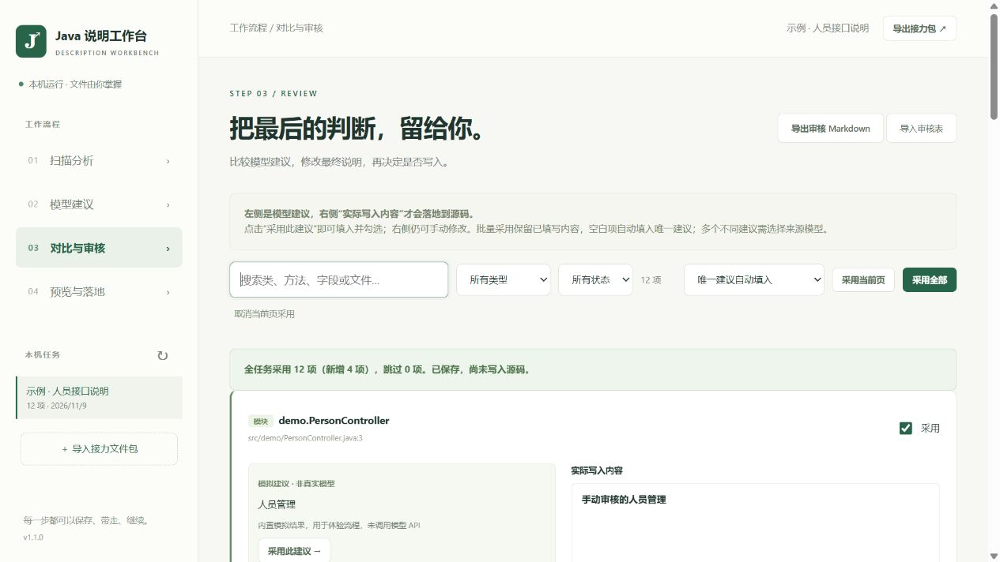
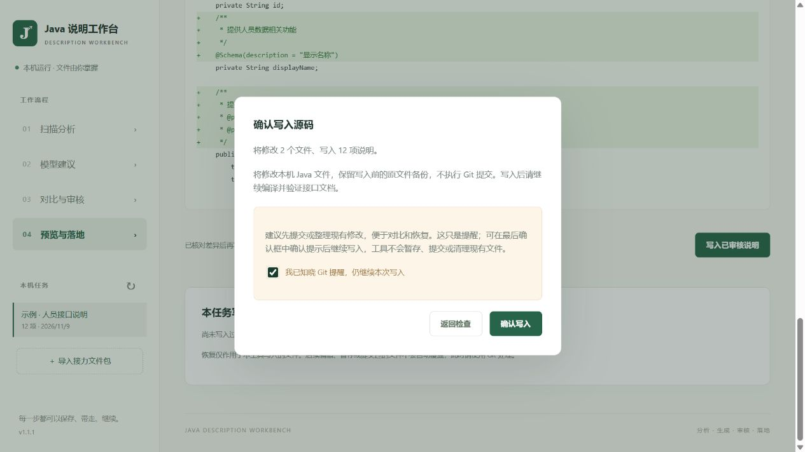
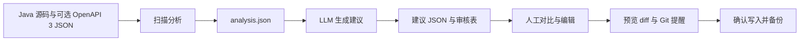

# Java 说明工作台 · Swagger Workbench

**为 Java 项目补全 Swagger 3 说明与 JavaDoc：扫描源码 → LLM 生成建议 → 人工对比审核 → 预览并写回源码。**

本地运行，浏览器操作。支持 DeepSeek、兼容 OpenAI Chat Completions 协议的模型服务和本机 Ollama。各阶段通过 JSON / Markdown / ZIP 独立保存，可以在不同电脑之间接力完成。

当前版本：**1.1.1**。完整参数及限制见 [使用说明](使用说明.md)，已有验证记录见 [测试报告](测试报告.md)。

## 适用场景

- **Java 老项目补文档**：Controller、接口方法、实体字段缺少中文说明，逐项手写工作量大。
- **Spring MVC / Spring Boot 接口说明补全**：结合 Java 源码与 OpenAPI 3 JSON，补充 `@Tag`、`@Operation`、`@Schema` 的缺失或空说明。
- **JavaDoc 补齐**：给缺少文档注释的类、方法、构造器和字段生成中文建议，校验参数、返回值和声明异常标签。
- **多人审核与跨电脑处理**：源码电脑只扫描；另一台能访问模型 API 的电脑生成并审核；最后回到源码电脑落地。
- **尝试多个 LLM**：保留不同服务或模型的结果，逐项比较建议，由人决定最终写入文本。

工具处理的是现有 Java 源码中的说明，不负责生成业务实现，也不将旧版 Swagger 2 注解自动迁移到 Swagger 3。

## 界面预览

截图来自内置的隔离示例，使用模拟建议，未调用付费模型。

### 模型建议对比、编辑与批量采用



### Git 提醒与写入确认



## 核心能力

| 能力 | 说明 |
| --- | --- |
| Java 语法树定位 | 使用 Tree-sitter Java 解析声明，以文件、完整类名及方法签名定位，支持多行注解、重载与内部类 |
| Swagger 3 说明 | 补充 `@Tag(name = "…")`、`@Operation(summary = "…")`、`@Schema(description = "…")`，保留已有非空说明及其他注解属性 |
| JavaDoc | 为缺少 JavaDoc 的声明生成文档内文，核对 `@param`、`@return`、`@throws`；保留已有 JavaDoc |
| LLM 建议 | 支持 DeepSeek、其他兼容 API、本机 Ollama；批次保存、失败续跑、不同模型建议对比 |
| 人工审核 | 逐项采用、当前页采用、全任务采用；保留手动编辑文本，多模型分歧可指定来源 |
| 独立文件 | 分析 JSON、建议 JSON、审核 JSON/Markdown 和完整 ZIP 均可导入导出 |
| 精确写回 | 模型只生成说明，程序编辑对应声明和 import；文件指纹变更时停止写入 |
| Git 与恢复 | Git 状态提醒、写入前预览、实际 Git diff、本次变更 diff、原文件备份及受保护恢复 |

## 工作流程



扫描只读，生成与审核不修改业务源码。只有最后确认写入，才会处理勾选“采用”的项目。

## 快速开始

### 方式一：Windows EXE

如果你已取得 Windows x64 便携包：

1. 解压后双击 `JavaDescriptionWorkbench.exe`。
2. 等待程序自动打开浏览器，默认地址为 `http://127.0.0.1:8765`。
3. 保留程序窗口，关闭该窗口会退出本地服务。

不需要安装 Python。端口被占用时，程序会尝试后续端口，以窗口打印的地址为准。源码仓库默认忽略 EXE 和 ZIP；也可以按下文自行构建。

### 方式二：从源码运行

需要 Python 3.10+；首次安装依赖需要网络。Windows 下可直接双击 `start.cmd`，自动创建环境、安装依赖并启动。

也可以在项目根目录的 PowerShell 中执行：

```powershell
python -m venv .venv
.\.venv\Scripts\python.exe -m pip install -r requirements.txt
.\.venv\Scripts\python.exe app.py
```

扫描与生成本身不需要 JDK、Maven 或 Gradle。写入目标项目后，仍应使用该项目原本的构建工具验证。Git for Windows 用于 Git 对比及内置示例；没有 Git 时，也可确认提示后使用文件备份和本次变更 diff。

### 先用示例体验

在首页点击 **“创建隔离示例”**，即可体验模拟建议、审核、预览、写入和恢复。需要本机 Git；工具只会为新生成的示例仓库创建基线提交，不会提交你的业务仓库，也不会调用付费 API。

## 使用步骤

### 1. 扫描分析

填写本机项目根目录，扫描目录使用相对路径，每行一个，例如：

```text
demo-service/src/main/java
demo-domain/src/main/java
```

单模块项目可填写 `src/main/java`；留空扫描项目内的 Java 文件，排除 `target`、`build` 等目录。

选择 Swagger、JavaDoc 或两者。Swagger 字段扫描需要 OpenAPI 3 JSON，可以填写服务地址：

```text
http://127.0.0.1:8080/v3/api-docs
```

也可以选择本地 JSON 文件；没有 OpenAPI 时，仍可扫描直接声明的 Controller、接口方法和 JavaDoc。Java 模型与 schema 无法唯一对应时，列入跳过清单，不猜测写入位置。

“包含源码片段”决定分析包是否携带供模型参考的截断声明片段。导出前可在审核页查看各项源码和上下文。

### 2. 配置 LLM 并生成

| 服务类型 | 基础地址示例 | 模型与密钥 |
| --- | --- | --- |
| DeepSeek 官方 API | `https://api.deepseek.com` | 填写该平台支持的模型名称和 API Key |
| 其他兼容 API | 服务商提供的基础地址，可带 `/v1` | 使用同一服务商的模型名及 Key |
| 本机 Ollama | `http://127.0.0.1:11434` | 提前拉取模型，例如 `qwen2.5:7b`，无须 Key |

程序会补全 `/chat/completions` 或 Ollama `/api/chat` 路径。模型列表和服务商参数可能不同，请按你实际使用的平台填写。

- 默认每批 5 项；可以只生成 Swagger 或 JavaDoc。
- 同一模型及输出配置再次运行时，跳过已完成项，继续未完成批次。
- 换模型或服务地址再次生成，结果会分别保留。
- “测试连接”仅查询模型列表，不发送源码；它不等于完成实际生成验证。
- DNS、证书、代理和超时问题可查看提示，并导出脱敏诊断。诊断仍可能包含自定义 API 地址、模型名称，分享前应检查。
- 公开 API 由服务商计费，模型建议仍需人工核实。

### 3. 对比与审核

**左侧是模型建议，右侧“实际写入内容”才是最终添加到源码的文本。**

| 操作 | 行为 |
| --- | --- |
| 采用此建议 | 将指定建议填入右侧，同时勾选采用 |
| 手动编辑 | 可修改最终文本；只有勾选采用才参与落地 |
| 采用当前页 | 处理当前页，保留已填写文本；空白项填入唯一建议 |
| 采用全部 | 处理全任务，包括其他页及筛选之外的项；确认框显示范围 |
| 批量采用来源 | 多个模型建议不同时，可指定一个来源；未指定的分歧项会跳过 |
| 取消当前页采用 | 取消当前页的采用标记，保留文本 |

默认不采用；更改自动保存。批量操作显示采用、新增与跳过数量及原因。也可导出 `review.md` 离线审核，再导入配套任务。

### 4. 预览与落地

1. 填写本机的目标项目根目录。
2. 生成差异预览，逐文件查看本次准备写入的内容。
3. Git 存在未提交改动时只作提醒；可先整理，也可在最后确认框勾选已知晓后继续。
4. 确认写入后，查看 Git diff 和“本次变更 diff”。后者只记录本工具的增删，包含未跟踪文件；上下文行可能包含原有代码。
5. 在目标项目中编译、刷新 OpenAPI 并验证文档，再自行决定是否提交 Git。

备份包含写入前的当前文件，包括原有业务改动。工具不暂存、提交、重置或清理业务仓库。若源码在扫描后变化，或声明位置、预览内容等发生冲突，仍会停止要求重新扫描/预览。恢复只作用于本工具写入的文件；后续编辑、暂存或提交变化可能阻止自动恢复。

## 跨电脑接力

```text
A 电脑：扫描源码 → 导出分析 JSON 或接力 ZIP
B 电脑：导入 → 调用 LLM → 人工审核 → 导出审核结果或接力 ZIP
A 电脑：导入 → 重新选择本机项目路径 → 预览 → 确认写入
```

B 电脑不需要完整源码项目，只需工作台和分析文件。源码片段和上下文已经随分析项携带；是否允许转移或发给外部模型，需要按项目的数据要求决定。

| 文件 | 内容与用途 |
| --- | --- |
| `analysis.json` | 缺失项、相对路径、声明签名、文件指纹、可选源码片段 |
| `suggestions.json` | 带分析指纹的模型建议，可独立导入配套任务 |
| `review.json` / `review.md` | 人工最终文本和采用选择 |
| 完整接力 ZIP | 包含以上文件及校验清单，推荐用于跨电脑传递 |
| `changes.diff` | 写入前预览 |
| `tool.diff` | 本工具本次修改的 diff |
| `git.diff` | 可取得的 Git HEAD diff，可能包含目标文件原有改动 |

使用本工具 version 1 数据格式。旧版独立 Python 脚本的 JSON/Markdown 不直接兼容。不要直接修改 ZIP 内的文件；需要离线编辑时使用导出的审核 Markdown。

## 数据保存与隐私

- 任务、审核和源码备份默认存放在 `%LOCALAPPDATA%\JavaDescriptionWorkbench`。
- API Key 不主动写入磁盘、浏览器本地存储或文件包；任务执行期间仅用于请求。勿将 Key 放入任务名称、源码或说明文本。
- 调用公开模型会发送分析项的元数据、上下文及所携带源码片段；选择 Ollama 可使用本机模型处理。
- 导出包不携带应用的本机项目根目录配置、原文件备份或专门的 Key 字段；但源码文本、注释、自定义地址或手动填写内容仍可能含业务信息，**任务包不是自动脱敏后的公开样本**。
- `.gitignore` 排除了本地环境、IDE 配置、构建产物、任务、备份、诊断文件及凭据文件。不要使用强制添加把这些内容带入源码提交。

可通过参数改变本地保存位置与端口：

```powershell
.\.venv\Scripts\python.exe app.py --data-dir "D:\WorkbenchData" --port 8877
```

增加 `--no-browser` 可以只启动服务，不自动打开浏览器。

## 开发、验证与打包

### 自动测试

```powershell
.\.venv\Scripts\python.exe -m unittest discover -s tests -v
```

目前包含 48 项自动测试，覆盖语法树定位、批量审核、模型结果校验、文件包接力、Git 提醒后写入、原有暂存及未暂存内容保留、备份恢复等。安装 JDK 时还会编译并检查示例 JavaDoc。历史 EXE 验证与真实模型调用的验证边界见 [测试报告](测试报告.md)。

### Windows EXE 构建

```powershell
.\build.ps1
```

脚本安装构建依赖、执行测试，通过后使用 PyInstaller 生成：

```text
dist/
├─ JavaDescriptionWorkbench.exe
├─ JavaDescriptionWorkbench-Windows-x64.zip
├─ JavaDescriptionWorkbench-Source.zip
├─ 使用说明.md
└─ licenses/
```

构建需在 Windows 上进行；已验证的 EXE 为 Windows x64 版本。构建完成后可额外运行打包程序的完整流程验证：

```powershell
.\.venv\Scripts\python.exe scripts/smoke_exe.py dist/JavaDescriptionWorkbench.exe
```

`build/` 和 `dist/` 含本机路径、示例任务或二进制产物，默认不提交。分发安装包前应另行检查，源码提交不等于已经审查旧安装包中的全部内容。

## 项目结构

```text
app.py                 本地服务入口与单实例保护
workbench/
  java_source.py       Java 语法树与局部编辑
  scanner.py           扫描与 OpenAPI 字段映射
  models.py            LLM 调用与返回校验
  network.py           TLS、代理及网络错误分类
  review.py            批量审核规则
  changes.py           diff、Git 状态、写入与恢复
  storage.py           任务与阶段文件导入导出
  server.py            本机 HTTP 接口
static/                HTML / CSS / JavaScript 操作界面
tests/                 自动测试
scripts/               EXE 验证、源码包与依赖许可收集
artifacts/             示例运行截图
start.cmd              源码启动脚本
build.ps1              Windows 构建脚本
```

## 当前限制

- 面向 Java、Spring Controller 的直接注解及 Swagger v3 注解；不保证组合元注解、接口继承映射、复杂 Jackson 命名策略完整覆盖。
- record 声明可生成 JavaDoc，但 record 组件字段、动态 Map 属性等不自动回写 Schema。
- 同名模型不唯一、多字段共用一个声明等不明确情况跳过，不猜测目标。
- 只处理可解析的 UTF-8 / UTF-8 BOM Java 源文件，保留原有行尾和未编辑字节。
- JavaDoc 默认保留已有文档；不自动重写非空 Swagger 说明。
- LLM 不进行完整业务调用链验证；语法树检查不等于编译、JavaDoc doclint 或业务测试通过。
- 本地服务绑定回环地址，面向单机使用，不作为互联网多用户服务部署。

## 第三方组件

Python、Tree-sitter、Tree-sitter Java、certifi 和 PyInstaller 的许可信息见 [THIRD_PARTY_NOTICES.txt](THIRD_PARTY_NOTICES.txt)。构建时会收集依赖许可文本。仓库当前未指定本项目自身的许可证；公开分享前可根据维护者意愿补充 `LICENSE`，第三方许可不替代本项目许可。
